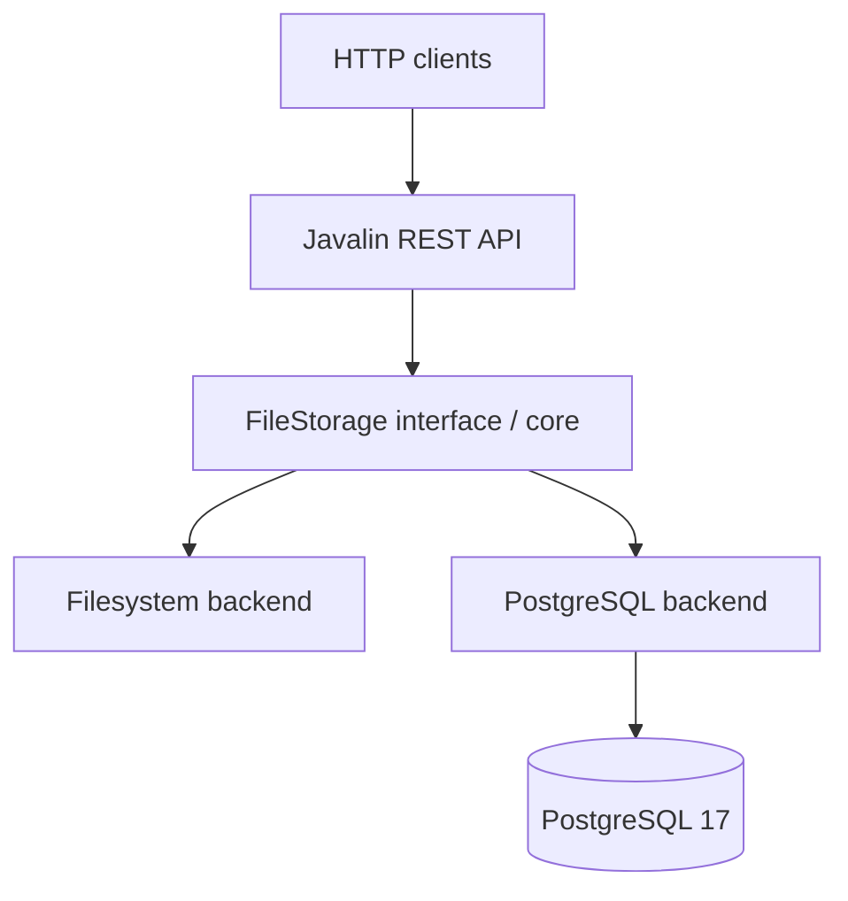
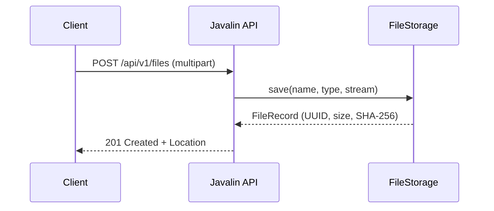
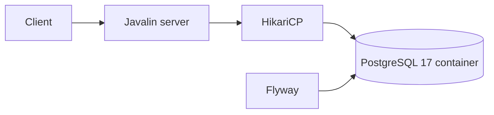

# Riddler File Server — Java 21

A standalone, framework-free file storage REST service and reusable Java library. **No Spring**.

## Modules

| Module | Responsibility |
|---|---|
| `riddler-core` | Storage API, metadata and validation |
| `riddler-storage-filesystem` | Local disk storage and metadata |
| `riddler-storage-postgres` | PostgreSQL `bytea` backend with Flyway |
| `riddler-server` | Javalin HTTP server and Swagger UI |

## Quick start

Requires **JDK 21** and **Maven 3.9+**.

```bash
mvn clean verify
java -jar riddler-server/target/riddler-server-3.0.0-SNAPSHOT.jar
```

The default filesystem backend stores files in `./data`. Swagger UI: **http://localhost:7070/swagger**. OpenAPI YAML: **http://localhost:7070/openapi.yaml**.

PostgreSQL is provided as a persistent Docker Compose service. Copy `.env.example` to `.env` to customize credentials (development defaults are **not production secrets**).

Start the database only:

```bash
docker compose up -d postgres
```

To build and run **both server and PostgreSQL in containers**:

```bash
docker compose --profile full up --build -d
curl http://localhost:7070/health/ready
```

To run with PostgreSQL from your host JVM:

```bash
docker compose up -d
STORAGE_TYPE=postgres DB_URL=jdbc:postgresql://localhost:5432/riddler DB_USER=riddler DB_PASSWORD=riddler java -jar riddler-server/target/riddler-server-3.0.0-SNAPSHOT.jar
```

Windows PowerShell: set environment variables with `$env:STORAGE_TYPE='postgres'` (and likewise for the DB variables) before running Java.

## Example calls

```bash
curl -F "file=@example.txt" http://localhost:7070/api/v1/files
curl 'http://localhost:7070/api/v1/files?limit=20&offset=0'
curl -o downloaded.bin http://localhost:7070/api/v1/files/UUID
curl http://localhost:7070/api/v1/files/UUID/metadata
curl -X DELETE http://localhost:7070/api/v1/files/UUID
```

## Architecture



## Upload sequence



## Configuration

| Variable | Default | Description |
|---|---|---|
| `PORT` | `7070` | HTTP port |
| `STORAGE_TYPE` | `filesystem` | `filesystem` or `postgres` |
| `STORAGE_PATH` | `./data` | Filesystem directory |
| `MAX_UPLOAD_BYTES` | `26214400` | Upload size limit |
| `DB_URL` | `jdbc:postgresql://localhost:5432/riddler` | JDBC URL |
| `DB_USER` | `riddler` | Database user |
| `DB_PASSWORD` | `riddler` | Database password; override in deployment |

## Limitations / production hardening

- PostgreSQL `bytea` downloads are currently buffered in JVM memory. Prefer filesystem backend for large files; move PostgreSQL storage to large objects or object storage if true streaming is required.
- Filesystem listing scans metadata files; replace with an indexed catalog for very large collections.
- Filesystem metadata and file content are separate files; a process crash can leave orphans. Add reconciliation before using in high-availability deployments.
- Swagger UI requires internet access to fetch its CDN assets.
- Add authentication/authorization, rate limits, malware scanning, backup/restore, metrics, integration tests, and atomic metadata handling before exposing publicly.
- File deletion is permanent. Add retention policies if required.

See [Architecture](docs/architecture.md) for design trade-offs and [API](docs/api.md) for endpoint details.

## Lifecycle and recovery

See [Storage lifecycle](docs/lifecycle.md) for startup, shutdown, upload commit behavior, and crash recovery limitations.



Stop services without removing data: `docker compose --profile full down`. **Warning:** `docker compose down -v` permanently removes the database volume.
