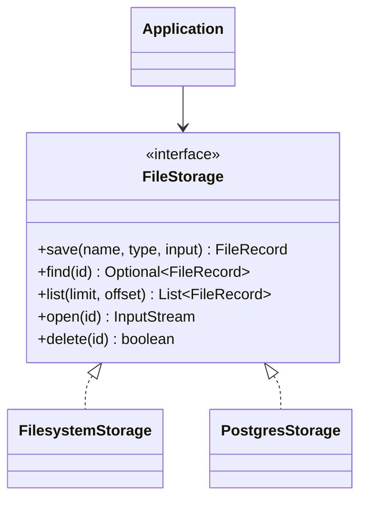
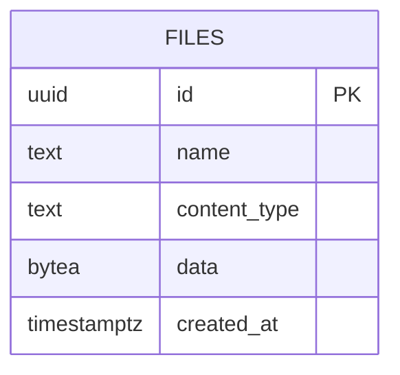

# Architecture and design decisions

## Design goals

1. Java 21 without Spring or dependency injection frameworks.
2. Core storage API can be embedded in another Maven reactor.
3. HTTP boundary is separate from storage adapters.
4. UUID-based addressing prevents filename/path-based lookup attacks.
5. Flyway owns PostgreSQL schema changes.

## Components

## PostgreSQL data model

## Trade-offs

- JDBC keeps persistence transparent and removes ORM complexity.
- Filesystem storage uses bounded-memory copy and a temporary file before publication.
- PostgreSQL `bytea` is convenient but not a true streaming large-file backend; downloads are buffered.
- SHA-256 is computed for metadata; PostgreSQL calculates it from stored bytes.
- A production deployment should define identity, authorization and upload scanning policies.
