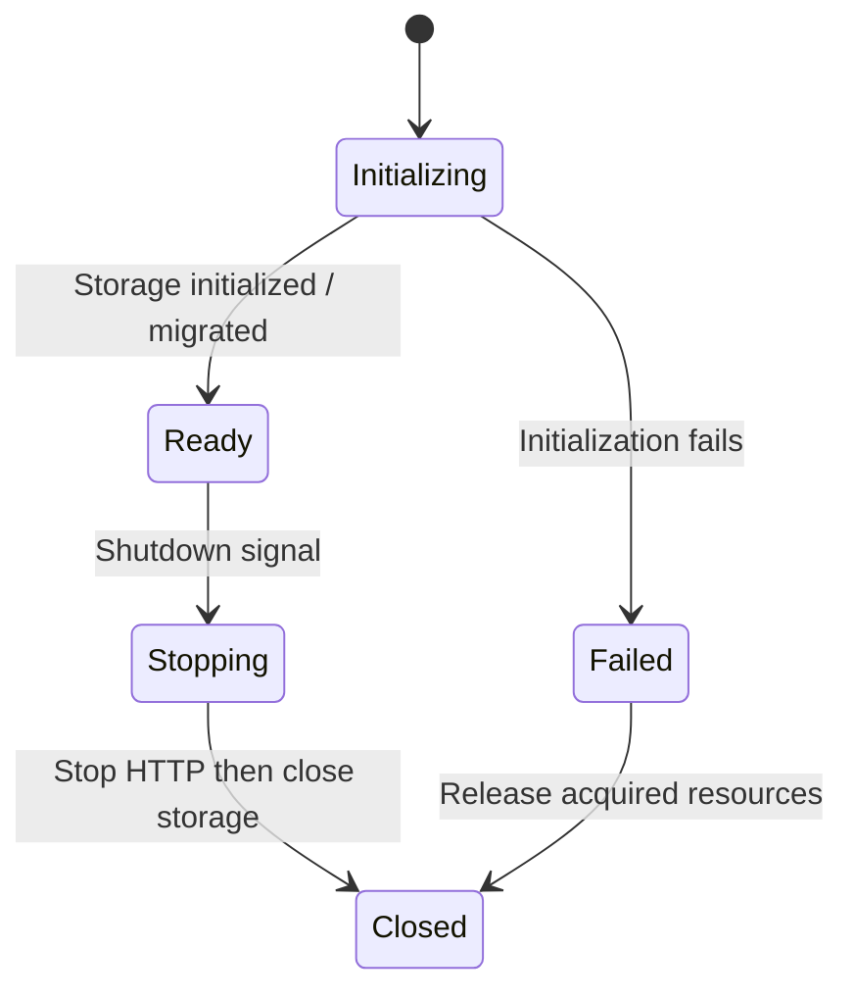
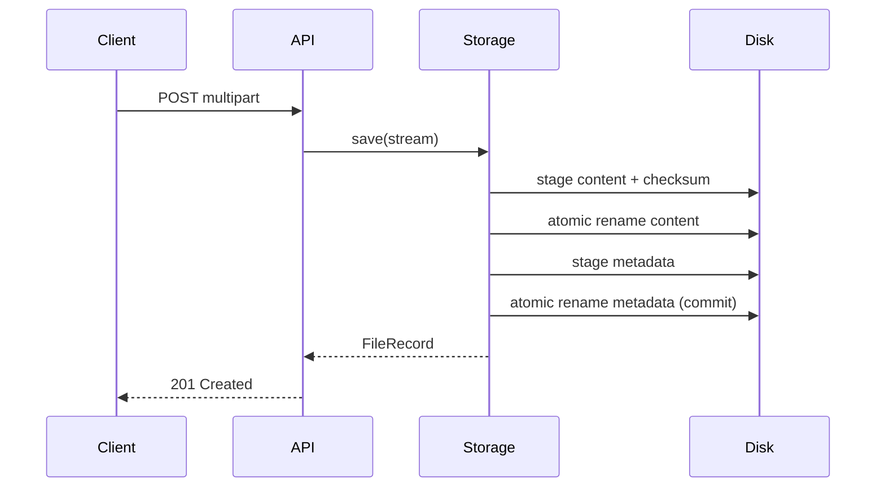

# Storage lifecycle and failure recovery

## Startup

1. Select the backend from `STORAGE_TYPE`.
2. For PostgreSQL, initialize HikariCP and run Flyway migrations before starting HTTP.
3. If migrations fail, close the pool and abort startup (fail fast).
4. For filesystem, remove abandoned `upload-*.tmp` staging files. **Run only one server process per storage directory**.
5. Start HTTP; `/health/live` is liveness and `/health/ready` checks storage connectivity.

## Upload commit behavior

**PostgreSQL:** each insert is atomic within a database transaction. Temporary staging files are deleted in a `finally` block. Flyway manages schema changes. PostgreSQL `bytea` may still buffer payloads inside the JDBC driver; for multi-GB objects prefer an object store or PostgreSQL large-object design.

**Filesystem:** content is staged to a temporary file, checksummed, then atomically renamed to the final `.bin` path. Metadata is written to a separate temporary file and atomically renamed last. Metadata is the *commit marker*: a file without published metadata is not visible through the API. A crash between the two renames can leave an orphan `.bin` file; a future maintenance reconciliation command should identify and quarantine those orphans. Filesystem and PostgreSQL operations are not distributed transactions.

## Shutdown

A JVM shutdown hook stops the HTTP server before closing storage. Existing long-lived requests must be drained by the hosting proxy/orchestrator; an explicit request-drain mechanism is not yet implemented. The PostgreSQL download stream now owns and closes its JDBC result set, statement, and connection on stream close. Callers **must close streams**.

## Known gaps

- Add reconciliation for orphan `.bin` files and malformed metadata.
- Add a request-draining lifecycle and explicit in-flight operation tracking.
- Add failure-injection tests and Testcontainers-based PostgreSQL integration tests.
- Add per-file locking or a single-writer guarantee for shared filesystem storage.
- Validate container startup with Docker and Maven in CI.
- Add authentication, authorization and backup policy before production use.
